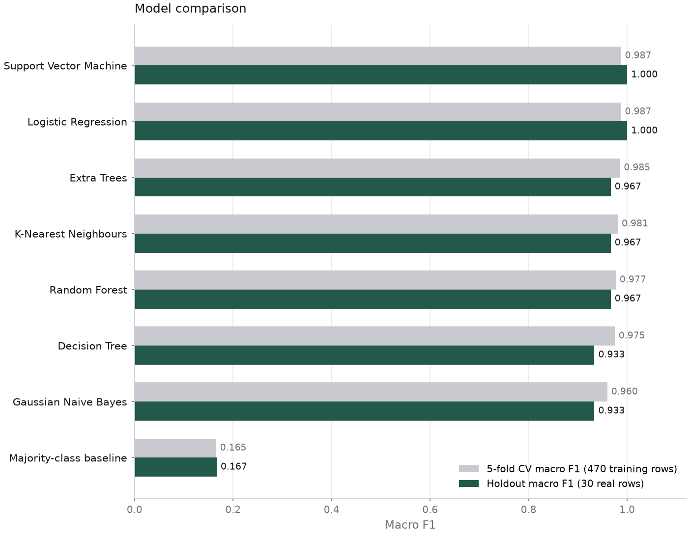
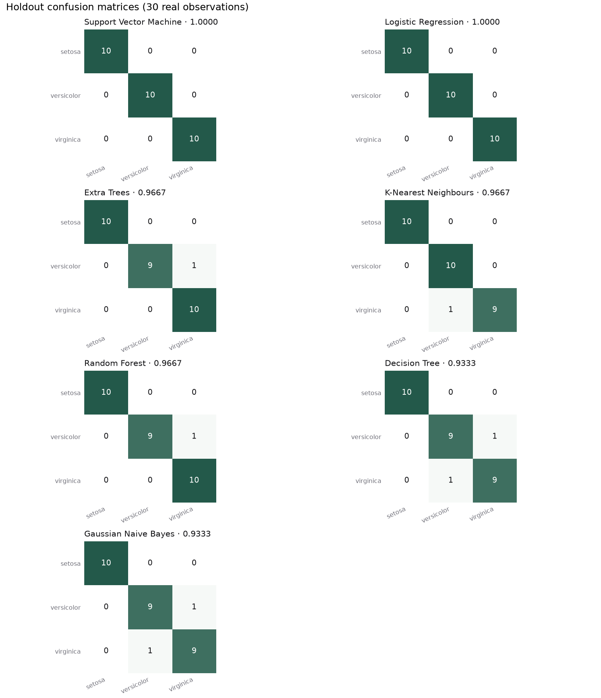

# Iris Flower Classification with Documented Synthetic Augmentation

**A reproducible comparison of seven classifiers and a deployed web prediction system**

Author: _[Your name]_
Institution: _[Your institution]_
Date: 16 November 2026

---

## Abstract

This report describes an end-to-end Iris flower classification system built
from the dataset distributed with scikit-learn. The required 500 observations
comprise the 150 real measurements and 350 synthetic rows generated from the
real training split only. Seven classifiers were tuned with stratified
five-fold cross-validation and compared with a majority-class baseline using
accuracy, macro precision, macro recall, macro F1 and confusion matrices. The
selected model, an RBF support vector machine with `C = 100` and
`gamma = 0.01`, achieved a cross-validated macro F1 of 0.987 ± 0.012 and
classified all 30 real holdout observations correctly (accuracy 1.000, macro
F1 1.000). The trained pipeline was exported to a portable JSON specification
and reimplemented in TypeScript for deployment on Vercel, with parity against
scikit-learn verified on 500 frozen cases. The report argues that the headline
holdout result should be read alongside the cross-validated estimate and the
dataset's limitations, not as evidence of perfect field performance.

## 1. Introduction

The Iris dataset is a standard benchmark for supervised classification. Each
observation describes a flower using four continuous measurements: sepal
length, sepal width, petal length and petal width. The task is to assign the
observation to one of three species: *Iris setosa*, *Iris versicolor* or
*Iris virginica*.

This project addresses five practical requirements:

1. use the scikit-learn Iris dataset and produce exactly 500 observations;
2. identify and document every synthetic observation;
3. train and compare multiple classification algorithms;
4. evaluate them with accuracy, precision, recall, F1 and a confusion matrix;
5. save the best model and expose it through a web interface that accepts the
   four measurements and returns a prediction.

The contribution is not a new algorithm. It is a complete, auditable workflow:
a leakage-free data design, a pre-declared model-selection rule, reproducible
artifacts, an honest treatment of synthetic data, and a deployed system whose
runtime predictions are checked against the trained model.

## 2. Background

### 2.1 The data

The measurements were published by Fisher (1936) and have since been used
extensively in statistics and machine learning. The scikit-learn distribution
contains 150 rows, 50 per species. Setosa is linearly separable from the other
two species in most feature projections; versicolor and virginica overlap,
especially in sepal measurements. Petal length and petal width carry most of
the discriminative signal.

### 2.2 Candidate algorithms

The comparison covers distinct inductive biases:

- **Logistic Regression**, a linear probabilistic model.
- **K-Nearest Neighbours**, an instance-based method that predicts from local
  neighbourhoods.
- **Gaussian Naive Bayes**, a generative model with a conditional independence
  assumption.
- **Decision Tree**, a recursive partitioner.
- **Random Forest**, a bagged ensemble of decorrelated trees.
- **Extra Trees**, a randomised ensemble with random split thresholds.
- **Support Vector Machine with an RBF kernel**, a margin-based method that
  maps inputs into a higher-dimensional space.

A majority-class `DummyClassifier` provides a reference point and is excluded
from selection.

## 3. Methodology

### 3.1 Dataset construction

The 150 real rows are loaded with `sklearn.datasets.load_iris`. A stratified
split with `random_state=42` holds out 30 real rows, 10 per species, leaving
120 real rows for training (40 per species).

The 350 synthetic rows are generated **only from the 120 real training rows**:

For each species `c`, estimate

```text
mu_c    = mean of the 40 real training rows of species c
Sigma_c = cov(rows of species c) + 1e-6 * I
```

then draw the required number of samples from `N(mu_c, Sigma_c)` using
`numpy.random.default_rng(42)`. Each draw is clipped to the species' observed
per-feature minimum and maximum, rounded to 0.1 cm, and clipped again. The
ridge term keeps the covariance positive definite; the clipping prevents
implausible extrapolation; the rounding matches the precision of the source
data.

Synthetic counts are 117 setosa, 117 versicolor and 116 virginica. The full
dataset is therefore 500 rows, of which 470 are used for training
(120 real + 350 synthetic) and 30 for testing (all real).

This ordering matters. Generating synthetic rows from all 150 real
observations before splitting would allow information about the holdout
distribution to enter training through the generator. Here the holdout is
fixed first and never passed to the generator. The row order in
`data/iris_500.csv` is also explicit: real training rows, synthetic training
rows, then real holdout rows.

### 3.2 Preprocessing

Standardisation is applied inside each pipeline for Logistic Regression,
K-Nearest Neighbours and the SVC. The scaler is fitted within each
cross-validation fold, so no validation-fold statistics leak into training.
Tree-based and Naive Bayes models use raw features, since they do not benefit
from scaling in the same way and the split thresholds remain interpretable.

### 3.3 Tuning and selection

Hyperparameters are chosen with `GridSearchCV` using stratified five-fold
cross-validation on the 470 training rows, scored by macro F1. Macro F1 gives
each species equal weight regardless of support. The grid for each family is
recorded in `ml/src/iris_ml/train.py`; for example, the SVC searches
`C in {0.1, 1, 10, 100}` and `gamma in {scale, 0.01, 0.1, 1}`.

The selection rule was fixed before evaluation:

1. highest mean cross-validated macro F1 among eligible models;
2. lower fold standard deviation on a tie;
3. display name as a deterministic final tie-break.

The holdout is not used for tuning or selection. A second diagnostic,
"real-only CV", repeats five-fold cross-validation on the 120 real training
rows using the already tuned pipeline. It measures how the model behaves
without synthetic rows in the validation folds, but it is not used to choose
the winner.

### 3.4 Metrics

For each class, with true positives `TP`, false positives `FP` and false
negatives `FN`:

```text
precision = TP / (TP + FP)
recall    = TP / (TP + FN)
F1        = 2 * precision * recall / (precision + recall)
```

Macro precision, recall and F1 are unweighted means across the three classes.
Accuracy is the proportion of correctly classified observations. The confusion
matrix reports raw counts, with row-normalised values shown alongside in the
interface. ROC-AUC is computed one-vs-rest and averaged across classes.

Cross-validation is summarised by the mean and standard deviation of the five
fold scores. Standard deviation here is the population standard deviation
(`numpy.std`), which describes the spread of these five folds rather than
estimating a population parameter.

### 3.5 Deployment and parity

Training runs offline in Python. The selected pipeline is saved with joblib
for reproducibility and exported to JSON containing the scaler parameters,
support vectors, dual coefficients, intercept, kernel parameters and Platt
calibration constants.

A TypeScript engine reimplements the libsvm decision function and pairwise
probability coupling. This avoids a second runtime on Vercel and keeps the
deployed model inspectable. Parity is tested in two layers:

1. Python compares the JSON reference implementation with the fitted
   scikit-learn pipeline on 500 inputs and requires matching labels and
   probabilities within `1e-9` (SVC calibration within `1e-6`).
2. The same 500 inputs and expected outputs are frozen as fixtures and replayed
   by Vitest against the TypeScript engine.

The interface exposes a `POST /api/predict` endpoint with shared Zod
validation, a result panel with probabilities, and a scatter plot that places
the submitted specimen among the 500 observations.

## 4. Results

### 4.1 Model comparison

| Model | CV macro F1 | Real-only CV | Accuracy | Precision | Recall | F1 | ROC-AUC |
|---|---:|---:|---:|---:|---:|---:|---:|
| **Support Vector Machine** | **0.987 ± 0.012** | 0.967 | **1.000** | **1.000** | **1.000** | **1.000** | 1.000 |
| Logistic Regression | 0.987 ± 0.010 | 0.967 | 1.000 | 1.000 | 1.000 | 1.000 | 1.000 |
| Extra Trees | 0.985 ± 0.014 | 0.958 | 0.967 | 0.970 | 0.967 | 0.967 | 0.997 |
| K-Nearest Neighbours | 0.981 ± 0.028 | 0.958 | 0.967 | 0.970 | 0.967 | 0.967 | 0.973 |
| Random Forest | 0.977 ± 0.022 | 0.950 | 0.967 | 0.970 | 0.967 | 0.967 | 0.997 |
| Decision Tree | 0.975 ± 0.016 | 0.941 | 0.933 | 0.933 | 0.933 | 0.933 | 0.950 |
| Gaussian Naive Bayes | 0.960 ± 0.034 | 0.958 | 0.933 | 0.933 | 0.933 | 0.933 | 0.990 |
| Majority-class baseline | 0.165 | 0.167 | 0.333 | 0.111 | 0.333 | 0.167 | 0.500 |

Accuracy, precision, recall, F1 and ROC-AUC are holdout figures; precision,
recall and F1 are macro averages. CV and real-only CV are means over five
folds.

### 4.2 Selected model

The SVC has the highest mean CV macro F1 by a narrow margin over Logistic
Regression (0.987292 versus 0.987256). Its fold scores are 1.0000, 1.0000,
0.9682, 0.9788 and 0.9894. The tuned parameters are:

```text
C = 100.0
gamma = 0.01
kernel = rbf
probability = True
```

On the 30 real holdout rows it achieves accuracy 1.000, macro precision 1.000,
macro recall 1.000, macro F1 1.000, weighted F1 1.000 and macro ROC-AUC 1.000.



*Figure 1. Cross-validated macro F1 on 470 training rows against holdout macro
F1 on 30 real observations.*

### 4.3 Confusion matrix

| True \ Predicted | Setosa | Versicolor | Virginica |
|---|---:|---:|---:|
| Setosa | 10 | 0 | 0 |
| Versicolor | 0 | 10 | 0 |
| Virginica | 0 | 0 | 10 |

Per-class precision, recall and F1 are all 1.000 with support 10. No holdout
observation was misclassified.



*Figure 2. Holdout confusion matrices for the seven eligible models. Setosa is
never confused; remaining errors occur between versicolor and virginica.*

The other models reveal where the boundary is difficult. Extra Trees and
Random Forest each classified one true versicolor as virginica. K-Nearest
Neighbours classified one true virginica as versicolor. Decision Tree and
Gaussian Naive Bayes made one error in each direction between the same two
species. The dataset's known overlap between versicolor and virginica is
therefore visible even though the selected model happened to make no holdout
errors.

## 5. Discussion

### 5.1 Why the scores are high

Iris is a small, clean, low-dimensional dataset. Setosa is well separated, and
petal measurements are strongly informative. With 470 training rows, including
350 smooth synthetic draws concentrated inside the observed class ranges, even
simple models can fit the boundary closely. A near-perfect holdout result is
therefore expected for this benchmark; it is not evidence that the method would
generalise to noisier botanical data.

### 5.2 Synthetic augmentation

The real-only CV scores are consistently lower than the augmented CV scores
for the selected model (0.967 versus 0.987). This is consistent with synthetic
rows smoothing the decision boundary, but the comparison is descriptive only:
the real-only folds contain 120 rows and are therefore noisier, and the two
protocols differ in both sample size and class geometry. The experiment does
not isolate a causal effect of augmentation.

The synthetic rows are not independent observations. They add no new
biological information, and the distribution tests can only show that the
generated sample is compatible with the 40 real rows per species; they cannot
prove fidelity. This is why every headline metric is computed on real holdout
rows and why the dataset page states the method and seed prominently.

### 5.3 SVC versus Logistic Regression

The two leading models are statistically indistinguishable on this data. The
SVC's advantage in mean CV macro F1 is 0.000036, while its fold standard
deviation is larger (0.012 versus 0.010). The pre-declared rule selects the
SVC, but a report that presented the SVC as clearly superior would be
overstating the evidence. Logistic Regression is simpler, faster and easier to
explain, and would be a reasonable choice in a setting where interpretability
outweighs a negligible fitted-margin difference.

The export decision also matters: the SVC requires support vectors, dual
coefficients and Platt calibration, whereas Logistic Regression exports as a
small coefficient matrix. The SVC was retained because it won the declared
comparison, and the extra complexity is covered by the parity suite.

### 5.4 Uncertainty of a 30-row holdout

A 30/30 holdout result corresponds to an observed accuracy of 1.000, but the
95% Wilson score interval is approximately 0.886 to 1.000. The result is
compatible with a true accuracy in the high 80s or low 90s. The
cross-validated estimate and its fold spread are more informative than a single
perfect holdout, and both are reported in the interface.

## 6. Limitations and threats to validity

1. **Synthetic data.** Class-conditional Gaussians cannot represent
   multimodality, heavy tails or unobserved subgroups. Clipping and rounding
   further concentrate the draws inside the observed box.
2. **Small evaluation set.** Thirty holdout rows give wide uncertainty.
3. **Single split.** The holdout was fixed once for a clean protocol, but a
   different 30-row split could change the reported accuracy.
4. **Benchmark optimism.** Iris is easy and extensively studied. High accuracy
   here does not transfer to field conditions, other species or image-based
   identification.
5. **Custom inference engine.** The TypeScript implementation is tested against
   scikit-learn, but it is maintained separately. Changes to the exporter,
   engine or library versions require re-running the parity suite.
6. **Version sensitivity.** The SVC probability calibration uses private
   scikit-learn attributes (`_probA`, `_probB`), and `probability=True` is
   deprecated for removal in scikit-learn 1.11. The environment is pinned, and
   upgrades require retraining and revalidation.
7. **No measurement-error model.** Inputs are treated as exact. Real
   measurements include observer and instrument variation that the model does
   not represent.

## 7. Conclusion and future work

The project meets its requirements: a documented 500-row dataset, a comparison
of seven classifiers, a full metric and confusion-matrix evaluation, a saved
best model, and a deployed interface that predicts from four measurements. The
selected SVC achieves 0.987 ± 0.012 cross-validated macro F1 and 1.000 accuracy
on 30 real holdout rows. The more important result is the process: the holdout
is isolated before synthetic generation, the selection rule is fixed before
evaluation, every number is emitted by a reproducible pipeline, and the
deployed engine is checked against the trained model.

Future work could:

- repeat evaluation with repeated stratified cross-validation or nested CV to
  reduce split dependence;
- compare against a conventional 80/20 split over all 500 rows, clearly
  labelled as optimistic, to quantify the effect of the leakage-free design;
- replace the Gaussian generator with a copula or kernel density model and
  measure whether downstream calibration improves;
- add probability calibration diagnostics (reliability curves, Brier score);
- collect genuinely independent Iris measurements to test external validity.

## References

1. Fisher, R. A. (1936). The use of multiple measurements in taxonomic
   problems. *Annals of Eugenics*, 7(2), 179-188.
2. Pedregosa, F. et al. (2011). Scikit-learn: Machine learning in Python.
   *Journal of Machine Learning Research*, 12, 2825-2830.
3. Cortes, C. and Vapnik, V. (1995). Support-vector networks. *Machine
   Learning*, 20(3), 273-297.
4. Platt, J. C. (1999). Probabilistic outputs for support vector machines and
   comparisons to regularized likelihood methods. In *Advances in Large Margin
   Classifiers*.
5. Wu, T.-F., Lin, C.-J. and Weng, R. C. (2004). Probability estimates for
   multi-class classification by pairwise coupling. *Journal of Machine
   Learning Research*, 5, 975-1005.
6. Kohavi, R. (1995). A study of cross-validation and bootstrap for accuracy
   estimation and model selection. *IJCAI*, 1137-1143.
7. UCI Machine Learning Repository. Iris Data Set.
   <https://archive.ics.uci.edu/dataset/53/iris>
8. scikit-learn developers. *User Guide: Support Vector Machines* and
   *Model evaluation*. <https://scikit-learn.org/stable/>

## Appendix A: Reproduction

```bash
# Python environment and full pipeline
python -m venv ml/.venv
ml/.venv/Scripts/python.exe -m pip install -r ml/requirements.txt
ml/.venv/Scripts/python.exe ml/run_pipeline.py

# Python tests
cd ml
.venv/Scripts/python.exe -m pytest

# Web checks
cd ..
npm.cmd run typecheck
npm.cmd test
npm.cmd run build
```

## Appendix B: Artifact map

| Artifact | Contents |
|---|---|
| `data/iris_500.csv` | The 500 committed observations |
| `artifacts/metrics.json` | All metrics, CV folds, parameters, versions and hashes |
| `artifacts/model_comparison.csv` | Leaderboard in tabular form |
| `artifacts/best_model.joblib` | Selected scikit-learn pipeline |
| `artifacts/specs/*.json` | Portable specifications for every model family |
| `artifacts/specs/*.joblib` | Fitted artifacts used by parity tests |
| `artifacts/figures/` | Report-quality PNG figures |
| `lib/model/model.json` | Deployed SVC specification |
| `lib/model/summary.json` | Metrics and metadata used by the interface |
| `lib/model/points.json` | 500 observations for the scatter plot |
| `ml/tests/fixtures/parity_cases.json` | Frozen Python-to-TypeScript parity cases |

All metrics in this report were read from `artifacts/metrics.json`; none were
entered by hand.
